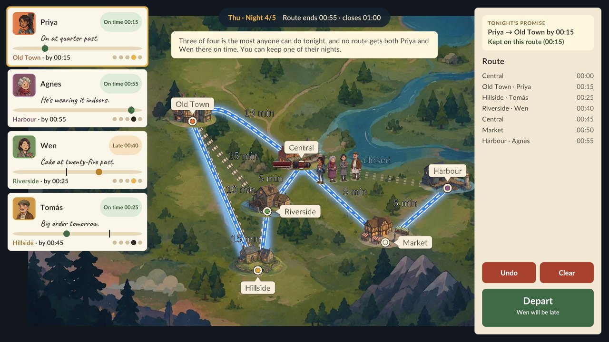
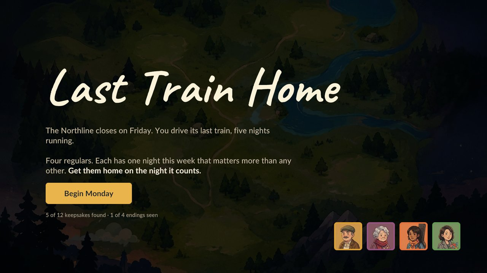
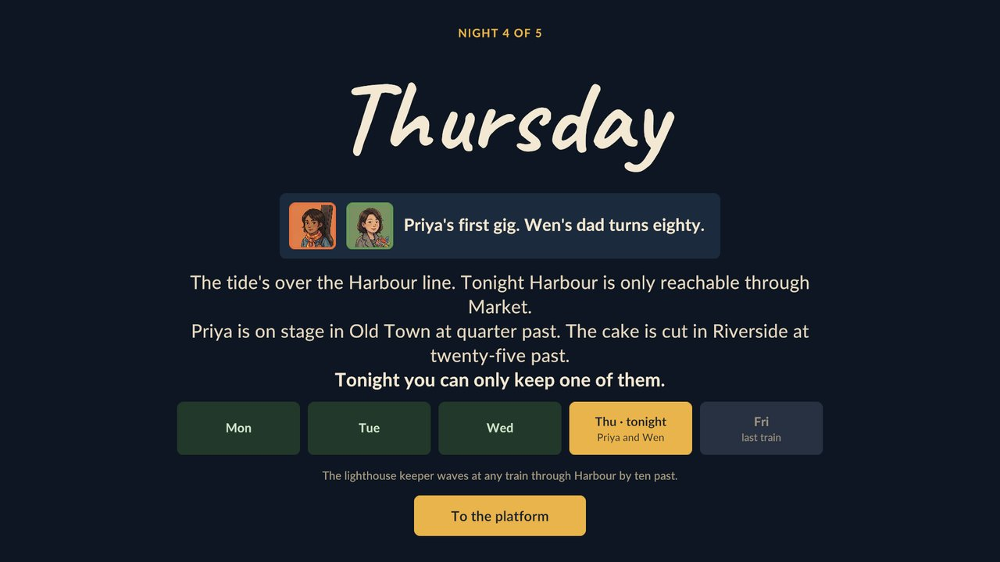
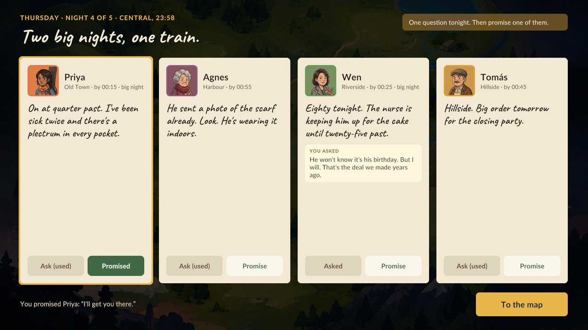
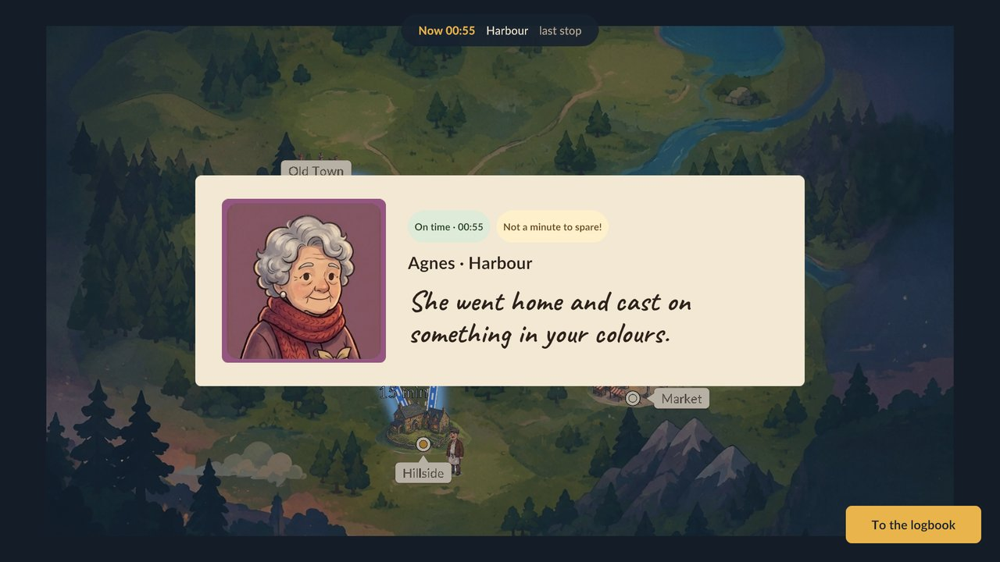

# Last Train Home

> *The Northline closes on Friday. You drive its last train, five nights running.*
> *Four regulars. Each has one night this week that matters more than any other.*
> **Get them home on the night it counts.**

A small, story-driven route-planning game made in Unity. Each night you meet your passengers on the platform, plan a
route across the city's rail map before the line closes, and watch who makes it home in time. Nobody can be on
time every night, so the game is about choosing whose night matters most.

About 15 minutes · mouse only · no saving needed

### ▶ [Play it on itch.io](https://faroghzahra.itch.io/last-train-home)



---

## How a night plays

1. **Night card.** The day, the stakes, and who is waiting at the platform.
2. **Platform.** Meet the regulars. You can **ask** someone how they are (one question a night from Tuesday on),
   and their answer can reveal their *big night*. Then **promise** one passenger: *"I'll get you there."*
3. **Plan.** Click stations to build a route along open track. Each stop shows who is on time, who is late and who
   is never reached, and whether your promise holds. Undo with right-click or **Ctrl+Z**.
4. **Ride.** The train runs your route and passengers get off at their stops.
5. **Logbook.** What happened to each passenger, plus any keepsakes they left you, such as a setlist taped to the
   cab window or a scrap of red wool tied to the brake handle.

Results carry over: what happens on Monday changes Tuesday, and the week ends with an epilogue for each regular,
depending on which big nights you kept. On Thursday two big nights fall at once, Priya's first gig and Wen's
dad's eightieth, at opposite ends of the line. No route reaches both in time, so you keep one and let the other go.

### Screenshots

| | |
|:---:|:---:|
|  |  |
| **The week ahead.** Four regulars, five nights. | **Night card.** Thursday: two big nights, one train. |
|  |  |
| **Platform.** Ask one question, make one promise. | **Ride.** Who made it home, and how. |

---

## Getting started

**Requirements**

- Unity **2022.3.62f3** (2022.3 LTS)
- Packages are restored automatically from `Packages/manifest.json`: Universal RP 2D, Input System, TextMeshPro and
  the Test Framework.

**Run it**

1. Clone the repo and open the folder in Unity Hub.
2. Open `Assets/Scenes/Main.unity`.
3. Press **Play**.

**Build:** *File ▸ Build Settings*, with `Main` as the only scene.

---

## Project structure

```
Assets/
├── Scripts/
│   ├── Domain/        Plain C# rules, no Unity references: network, routing, passengers, sessions, campaign
│   ├── Game/          Unity layer: content loading, flow (presenters), views, input, bootstrap
│   ├── Editor/        UiBuilder: builds and wires the UI canvas
│   └── Tests/         EditMode tests for Domain and Game
├── Data/
│   ├── Levels/        Night1–5.json: one file per night
│   ├── Story/         Week.json: title screen, cast, big nights, keepsakes, endings
│   ├── Text/          UiText.json: all interface wording
│   └── *.asset        Settings, palette and art lookups (ScriptableObjects)
├── Art/  Audio/  Fonts/  Scenes/
ArtSource/             Raw art sheets, kept outside Assets/
```

### Architecture

The code is split into three assemblies, and dependencies only point one way:

```
LastTrainHome.Domain   plain C# (noEngineReferences)   the rules
        ▲
LastTrainHome.Game     Unity                           content, flow, views, input
        ▲
LastTrainHome.Editor   Editor only                     UI builder
```

- **Domain** knows nothing about Unity. Routes, deadlines, outcomes and the campaign are all plain C#, so they can
  be unit-tested without a scene.
- **Flow** has one presenter per screen (Title, Night Card, Platform, Plan, Ride, Logbook), run in sequence by
  `GameFlow`. Presenters only see views through interfaces.
- **Views** are passive MonoBehaviours. They draw things and report clicks.
- **`GameBootstrap`** is the single composition root and the only place cross-object references live. It fails fast
  with one clear error if something isn't wired up.
- There are no gameplay coroutines. `GameFlow.Tick` drives the journey from `Update`.

### Every word comes from data

Code never holds English sentences. Map layouts, passenger lines for every outcome, carry-over variants, keepsakes,
endings and UI text all live in JSON. When content loads, every file is checked, along with how the files fit
together, and all problems are reported at once.

---

## Editing content

**Add or change a night**

1. Edit or add `Assets/Data/Levels/NightN.json` (the format is in `Game/Content/LevelFile.cs`), and add its day to
   `Data/Story/Week.json`.
2. Run **Last Train Home ▸ Set Up Content** to register every `Night*.json` in the level catalog.
3. Run the EditMode tests. `LevelBalanceTests` checks that every night after Monday is a real dilemma under every
   carry-over combination, and that when two big nights share a night only one of them can be kept.
   `python Design/level_solver.py Data/Levels/*.json --variants` (from `Assets/`) prints the same analysis.

**Change the UI**

Run **Last Train Home ▸ Build UI** to rebuild and rewire the whole canvas from `Scripts/Editor/UiBuilder.cs`, then
save the scene. Make layout changes there rather than by hand, so a rebuild doesn't lose them. Colours come from
`Data/UiStyle.asset`.

---

## Tests

Open *Window ▸ General ▸ Test Runner* and run all **EditMode** tests. They cover:

- **Domain:** clock, rail network, closed lines, routes, journey timeline, outcomes, sessions, campaign
- **Game:** level parsing, content checks, level balance, the full game flow (with fake views), and scene wiring.
  The wiring tests fail on any unassigned reference, missing script, or button listener set in the Inspector.

---

## Credits

- Made by **Syeda Farogh Zahra**
- Fonts: [Lato](https://fonts.google.com/specimen/Lato) and [Caveat](https://fonts.google.com/specimen/Caveat),
  under the SIL Open Font License (see `Assets/Fonts/*-OFL.txt`)
